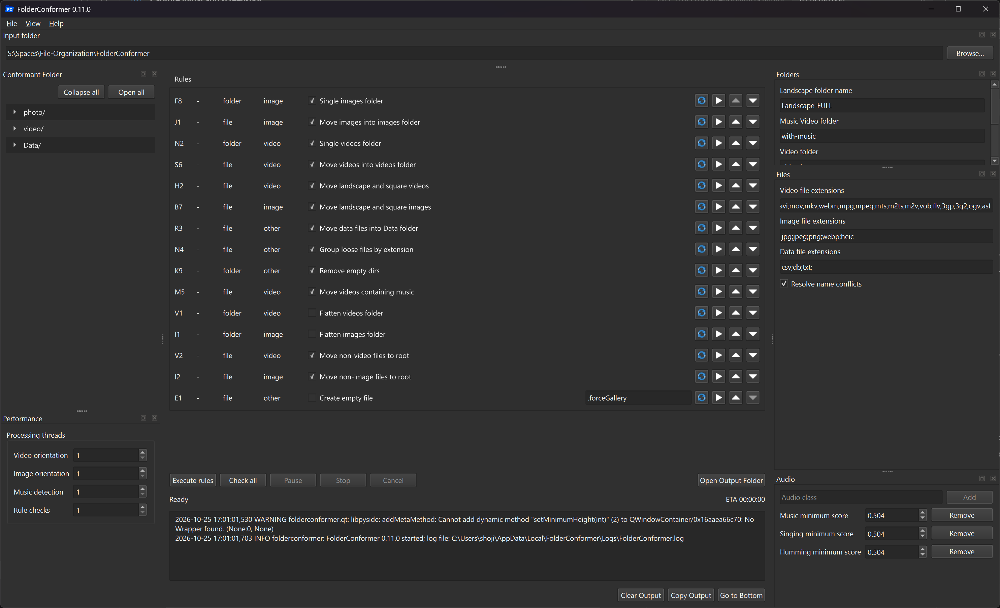

# FolderConformer

A Windows desktop app for organizing files into folders.

## Features

- Configurable, ordered rules with checks before execution. See the [rule reference](docs/RULES.md).
- File Explorer context-menu integration.
- Saved settings, adjustable dock layout, and themes.
- Parallel media analysis, progress tracking, and activity logs.

## Install

- Download the `FolderConformer-*-windows-amd64-Setup.exe` installer from [GitHub Releases](https://github.com/electblake/folderconformer/releases).
- Run the installer with an internet connection to download the required dependencies.
- Launch **FolderConformer** from the Start menu.
- Optional: select **Help > Install for File Explorer > Install** to add the folder context-menu entry.

